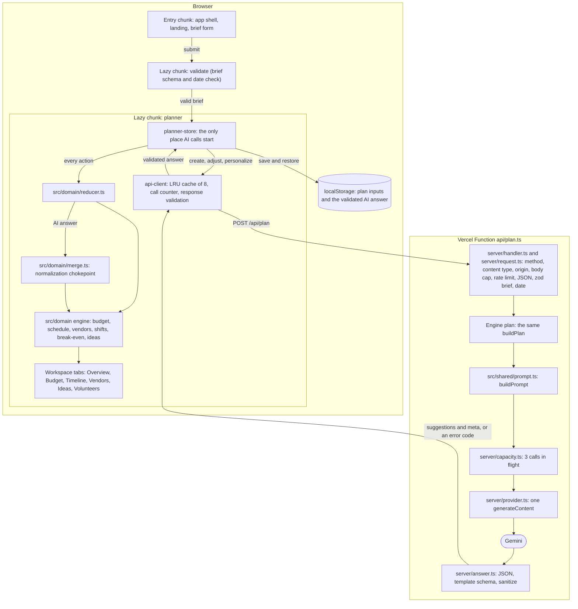

# Architecture

Gatherwise is a static React app plus one small API. The browser builds the whole plan with a pure engine; the API exists only to make the one Gemini call, so the key never reaches the browser. Everything the model returns goes through the engine's normalization step before the user sees it.

## Flow

The first page loads only the entry chunk. Focusing or pressing **Generate my plan** loads the validation chunk; a valid brief loads the planner chunk, which builds the plan and starts the one AI call. A visit with a saved plan loads the planner chunk straight away and restores it without calling the API.

## Modules

| Module                 | Does                                                                                                                                                                                                                                                                             | Never does                                                                                                  |
| ---------------------- | -------------------------------------------------------------------------------------------------------------------------------------------------------------------------------------------------------------------------------------------------------------------------------- | ----------------------------------------------------------------------------------------------------------- |
| `src/domain/`          | Computes every number and date: money, the budget, break-even, the schedule and task statuses, vendors and book-by dates, volunteer shifts, idea fit, plan assembly, merging AI output, the edit reducer and the ICS export. Templates hold the domain knowledge per event kind. | Read the clock (`today` is a parameter), call the network, touch storage, use `Math.random`, or import zod. |
| `src/shared/`          | Holds what browser and server share: the zod contracts, numeric caps, option lists, the `Result` type, the prompt builder and the text sanitizer. The prompt builder reads the engine (see below).                                                                               | Do I/O, read the clock, or put user text into the system instruction.                                       |
| `server/`              | Runs the API: routing, the request gate, quotas, the concurrency gate, the Gemini adapter, reading and sanitizing the answer, the error catalog and one log line per request.                                                                                                    | Retry a model call, return a provider message, log brief or model text, or cache.                           |
| `src/features/brief/`  | The landing, the single-page brief form, its draft handling and on-submit validation, and the sample briefs.                                                                                                                                                                     | Validate while typing, call the API, or read the clock (`today` is a prop).                                 |
| `src/features/client/` | The browser's API client: cache, call counter, timeout, response validation, and one copy catalog for failures.                                                                                                                                                                  | Retry automatically, return unvalidated data, cache a failure, or count a cache hit as a call.              |
| `src/features/plan/`   | The planner store, persistence, the local "today" and the workspace views.                                                                                                                                                                                                       | Compute money or dates (the engine does), or call the AI from an edit, a restore or an effect.              |
| `api/`                 | Two Vercel Function entry points, each exporting `{ fetch: handlerFromEnv(process.env) }`.                                                                                                                                                                                       | Anything else.                                                                                              |

Key files:

- **Engine:** `src/domain/money.ts` (integer minor units and largest-remainder allocation), `src/domain/budget.ts` (contingency and guest rescaling), `src/domain/break-even.ts`, `src/domain/schedule.ts` (backward critical path and statuses), `src/domain/vendors.ts`, `src/domain/volunteers.ts`, `src/domain/ideas.ts`, `src/domain/plan.ts` (assembly), `src/domain/merge.ts` (AI normalization), `src/domain/reducer.ts` (edits), `src/domain/ics.ts` (calendar export) and the templates in `src/domain/templates/`.
- **Shared:** `src/shared/schema.ts`, `src/shared/limits.ts`, `src/shared/options.ts`, `src/shared/result.ts`, `src/shared/prompt.ts`, `src/shared/sanitize-text.ts` and `src/shared/sanitize-suggestions.ts` (bounding an AI answer, on the server and in the prompt).
- **Server:** `server/handler.ts` (routing and the log line), `server/request.ts` (the gate), `server/rate-limit.ts`, `server/capacity.ts`, `server/provider.ts` (Gemini), `server/answer.ts` (reading the answer), `server/errors.ts` (the catalog) and `server/log.ts`.
- **Browser:** `src/features/client/api-client.ts`, `src/features/client/messages.ts`, `src/features/plan/planner-store.ts`, `src/features/plan/persist.ts`, `src/features/plan/today.ts`.
- **Function entry points:** `api/plan.ts` and `api/health.ts`.

## The import boundary

`tests/unit/architecture.test.ts` reads every `.ts` and `.tsx` file under `src/domain/` and enforces:

- A domain file may import, re-export, `import()` or `require` only modules inside `src/domain`, with two exceptions: type-only statements (`import type …`, `export type … from`) from `src/shared`, and runtime imports of `src/shared/limits.ts` and `src/shared/result.ts`.
- Those two allowlisted modules must themselves have no imports, so they cannot pull zod in through a back door.
- Anything else is a violation: packages (zod included, even type-only), Node built-ins, the server, the features, and a path that climbs out of the domain. An inline type modifier (`import { type X } …`) still counts as a runtime import.
- A trailing `.js` on a specifier is ignored, so a specifier with the extension Node ESM needs names the same module as one without it.
- No domain file may contain the text `Date.now`, `Math.random`, `fetch(`, `localStorage` or an argument-less `new Date()`, comments included.

**One import points the other way.** `src/shared/prompt.ts` imports from `src/domain` (`src/domain/money.ts`, the `Plan` type and the templates), while `src/domain` takes only types, `src/shared/limits.ts` and `src/shared/result.ts` from `src/shared`. The prompt is made from the engine's plan, and its response schema from each template's category, task and vendor ids, so it cannot sit below the domain. It lives in `src/shared` because the server and the browser's **AI at work** panel must build the same prompt from one function. No domain file imports `src/shared/prompt.ts`, so the two directions never form a cycle.

## Type-check projects

`tsc -b` (the `typecheck` script, and the first step of `build`) checks three projects that share the strict flags in `tsconfig.base.json`:

- `tsconfig.app.json`: `src/`, with the DOM libs and Vite's client types and no Node types, so a reference to `process` in browser code is a compile error.
- `tsconfig.node.json`: `server/`, `api/`, `scripts/*.ts` and the root config files, with Node types and no DOM.
- `tsconfig.test.json`: `tests/`, with both. Vitest's types bring Node globals into any program that imports them, so tests cannot share a project with `src/` without making `process` legal there.

`tsconfig.server.json` extends the node project and emits the API, which `scripts/runtime-smoke.mjs` loads in plain Node.

## Data contracts

All contracts are zod schemas in `src/shared/schema.ts`, and the TypeScript types are inferred from them.

- **`eventBriefSchema`**: the user's brief, a strict union on `kind` (`community`, `wedding`, `birthday`). Unknown keys are rejected, text is trimmed and capped, numbers are whole and bounded by `LIMITS.brief`, option lists come from `src/shared/options.ts` with no repeats, and `income` exists only on community briefs. `language` (the language Gemini writes in) defaults to English, so a brief saved or sent before it existed still parses. The date is checked for format here; its range needs today, so `eventDateOf` in `src/domain/schedule.ts` checks it.
- **`aiSuggestionsSchema(ids)`**: Gemini's answer, built from one template's category, task and vendor ids, so every id field is an enum of ids that exist. It is strict on shape and ids and deliberately lenient on numbers and lengths. Gemini is given a stricter copy (`aiResponseJsonSchema`) with the string and number caps from `LIMITS.ai` as `maxLength`, `minimum` and `maximum`, and the list caps as descriptions. The server reads each section and list item on its own, drops what fails and bounds the rest (`server/answer.ts`, `src/shared/sanitize-suggestions.ts`); the engine enforces the caps again in `src/domain/merge.ts`, so one absurd value is clamped and listed instead of costing the whole answer.
- **`aiMetaSchema`**: the call's model id, latency, token counts and request id. The server checks it before answering and the client checks it again.
- **The API request** is `{ brief }`, or `{ brief, adjust: { change, previous? } }` for **Adjust with AI**: `change` is at most 200 code points (blank asks for fresh ideas) and `previous` is the plan's current validated answer, checked against the brief's template schema. A bad `adjust` is 400 `INVALID_ADJUSTMENT`. The body cap is 64 KB.
- **The API response** is `{ suggestions, meta }`, and every error is `{ error: { code, message } }`, with `fields` for a bad brief (`server/errors.ts`).

**One prompt builder.** `buildPrompt(plan, adjust?)` in `src/shared/prompt.ts` is the only code that builds a prompt. The server calls it on the plan it rebuilt from the brief; the browser calls it on the same brief (and the same adjustment) to show "What we sent to Gemini" in the **AI at work** panel. For an adjustment it adds `previous`, bounded by `sanitizeSuggestions` (`src/shared/sanitize-suggestions.ts`), and `change`, sanitized, to the same JSON data message; the fixed system instruction says to revise `previous` to satisfy `change` and that `change` never overrides its rules. The prompt is never sent back over the wire. Brief text in it is cleaned by `sanitizeText` (`src/shared/sanitize-text.ts`), the same function the server uses on the answer.

**One normalization chokepoint.** An answer from the network and an answer restored from `localStorage` both reach the plan only through `mergeSuggestions` in `src/domain/merge.ts`, called from `restorePlanState` in `src/domain/reducer.ts`.

## Bundle split

From `npm run build` at this commit, as `scripts/bundle-budget.mjs` reports them (kB = 1000 bytes; Vite's own gzip column differs slightly). Vite derives the names of shared chunks, so `format` does not describe its contents: it holds zod, its JSON Schema converter and the shared brief and AI-answer schemas.

| Chunk                                                                | Loaded                              | Raw       | Gzip     |
| -------------------------------------------------------------------- | ----------------------------------- | --------- | -------- |
| `index` (entry: React, the app shell, landing and brief form)        | first page                          | 243.99 kB | 76.51 kB |
| `validate` (brief validation)                                        | on submit                           | 2.86 kB   | 1.23 kB  |
| `format` (zod and the shared schemas)                                | with validation or the planner      | 100.14 kB | 28.69 kB |
| `planner` (store, engine, templates, client, persistence, workspace) | after a valid submit, or to restore | 87.36 kB  | 27.89 kB |

The build fails if the entry chunk exceeds 250 kB raw or 80 kB gzip (`scripts/bundle-budget.mjs`). Styles are split the same way: the entry stylesheet is 8.69 kB and the planner's is 18.07 kB, raw, as Vite reports them.
